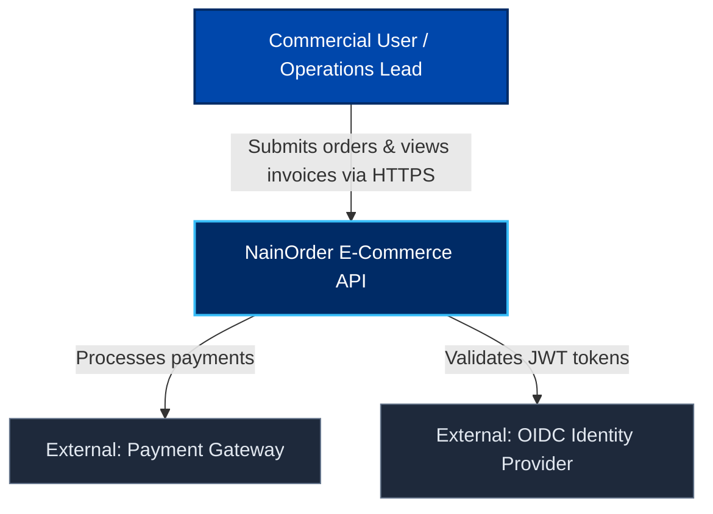
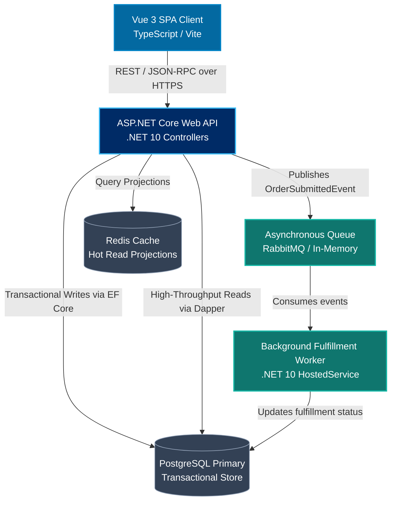
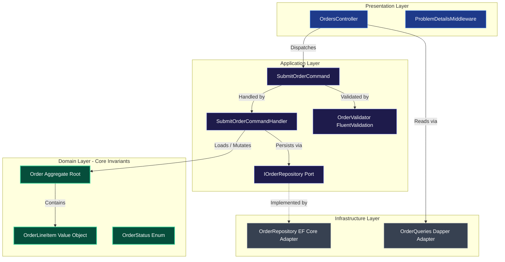

# C4 Architectural Modeling Standard (GitHub Mermaid)

> Standardized system architecture modeling across Context, Container, Component, and Code levels, formatted in GitHub-native Mermaid syntax.

---

## 1. Principles of C4 Modeling

Ad-hoc box-and-arrow diagrams create ambiguity because they mix logical boundaries, deployment nodes, and transport protocols. The **C4 Model** provides a hierarchical zoomable map of software systems:

1. **Level 1: System Context**: Who uses the system and how does it integrate into the external landscape?
2. **Level 2: Container**: What high-level executables, databases, and client frontends form the overall system?
3. **Level 3: Component**: What internal modular boundaries and Clean Architecture layers exist inside each container?
4. **Level 4: Code**: Class definitions, entity invariants, and interfaces.

> [!NOTE]
> GitHub's Markdown renderer does not natively parse `C4Context` keywords. NainDev models all C4 levels using GitHub-native `flowchart TB` syntax with explicit class styling and subgraphs for 100% reliable rendering.

---

## 2. Level 1: System Context Diagram

---

## 3. Level 2: Container Diagram

---

## 4. Level 3: Component Diagram (Clean Architecture)

