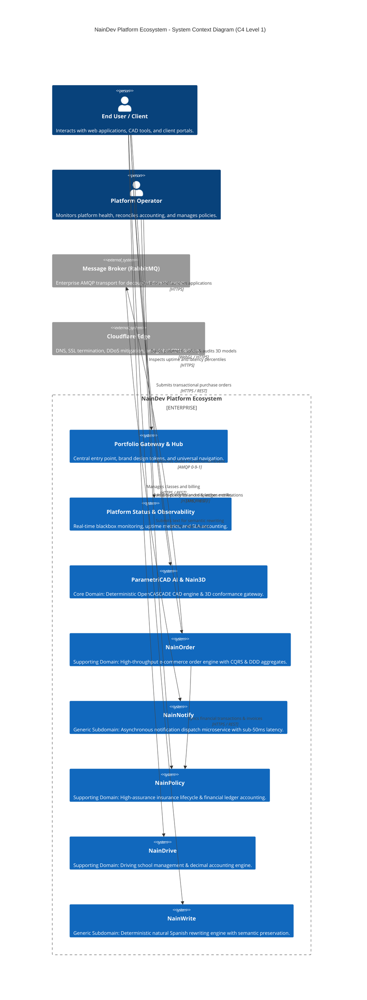
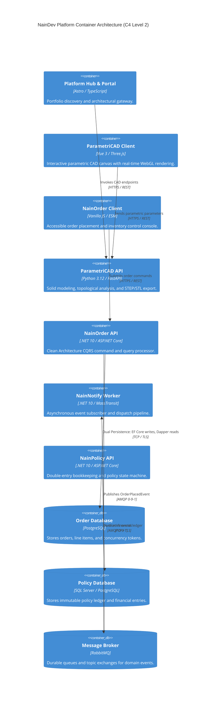

# NainDev Enterprise Context Map & System Topology

> Strategic Domain-Driven Design (DDD) context mapping, C4 architectural topology, and interaction blueprints across the NainDev platform ecosystem.

---

## 1. Executive Architecture Summary

The NainDev platform ecosystem is architected as a set of autonomous, highly cohesive Bounded Contexts. Rather than a monolithic codebase or an uncoordinated sprawl of microservices, each service adheres to strict strategic DDD boundaries, clear upstream/downstream integration contracts, and universal architectural invariants.



---

## 2. Strategic DDD Bounded Contexts

The ecosystem classifies all systems into four strategic quadrants:

```
+---------------------------------------------------------------------------------------+
|                                  CORE DOMAIN (Competitive Advantage)                  |
|  - ParametriCAD AI: Exact boundary representation (B-Rep) modeling via OpenCASCADE.    |
|  - Nain3D Gateway: Deterministic Khronos conformance & geometric invariant auditing.  |
+---------------------------------------------------------------------------------------+
|                                  SUPPORTING DOMAINS (Business Specific)               |
|  - NainOrder: CQRS order processing, stock reservations, and aggregate state.         |
|  - NainPolicy: Insurance policy lifecycle, actuarial calculations, financial ledger. |
|  - NainDrive: Fleet management, driving student scheduling, exact decimal billing.   |
+---------------------------------------------------------------------------------------+
|                                  GENERIC SUBDOMAINS (Utility / Shared)                |
|  - NainNotify: Asynchronous dispatch (email/SMS/webhooks) over MassTransit/RabbitMQ. |
|  - NainWrite: Natural Spanish text normalization and semantic invariant gating.       |
+---------------------------------------------------------------------------------------+
|                                  PLATFORM HUB & OBSERVABILITY                         |
|  - nain9dev.github.io: Single source of truth architectural gateway.                 |
|  - brandbook: Mathematical design tokens, color geometry, and accessible tokens.     |
|  - status: Serverless blackbox monitoring and rolling SLA verification.               |
+---------------------------------------------------------------------------------------+
```

---

## 3. Integration Patterns & Context Relationships

Between bounded contexts, strict relationship patterns govern data ownership and contract stability:

| Upstream Context | Downstream Context | Relationship Pattern | Protocol / Transport | Contract Guarantee |
| :--- | :--- | :--- | :--- | :--- |
| **NainOrder** | **NainNotify** | **Customer / Supplier** | AMQP 0-9-1 (RabbitMQ via MassTransit) | At-least-once delivery, decoupled asynchronous fire-and-forget, sub-50ms dispatch. |
| **NainOrder** | **NainPolicy** | **Published Language** | REST / HTTPS (RFC 7807 ProblemDetails) | Strongly typed transactional invoice payloads, integer cents currency representation. |
| **Nain3D** | **ParametriCAD AI** | **Shared Kernel** (Geometry Math) | In-process Python bindings (`trimesh`, `numpy`, OpenCASCADE) | Universal quantum threshold ($10^{-12}\text{ m}^2$), checks C1 through C10. |
| **NainConfigurator** | **Nain3D** | **Conformist** | HTTPS / GLB Artifact Exchange | Assets strictly conform to glTF 2.0 validation rubric before configuration rendering. |
| **External Clients** | **All Backends** | **Open Host Service (OHS)** | REST / JSON with OpenAPI 3.1 schema | Versioned routes, CORS allowlists, strict schema validation. |

---

## 4. Container Topology & Protocol Blueprint (C4 Level 2)



---

## 5. Universal Architectural Invariants

Every system inside the NainDev ecosystem enforces five non-negotiable invariants:

1. **Inward Dependency Rule**: Domain aggregates never import from Application, Infrastructure, or Presentation layers. Enforced via automated architecture fitness functions (`NetArchTest` in .NET, `AST` inspection in Python) in continuous integration.
2. **Deterministic Representation**: All financial amounts are stored as 64-bit integer cents (avoiding binary IEEE 754 floating-point inaccuracies). All 3D geometric validations execute against formal tolerance thresholds ($10^{-12}\text{ m}^2$).
3. **Optimistic Concurrency Control**: All state-modifying entities expose version tokens (`xmin` in PostgreSQL, `rowversion` in SQL Server, or integer version fields) to guarantee that race conditions result in clean `409 Conflict` responses rather than silent data overwrites.
4. **Structured Error Protocol (RFC 7807)**: API errors conform strictly to ProblemDetails JSON payloads, eliminating non-standard ad-hoc error formats and safeguarding internal stack traces from leaking to clients.
5. **Observability & Traceability**: All HTTP requests and AMQP messages carry W3C Trace Context headers (`traceparent`) for end-to-end distributed transaction tracing.
