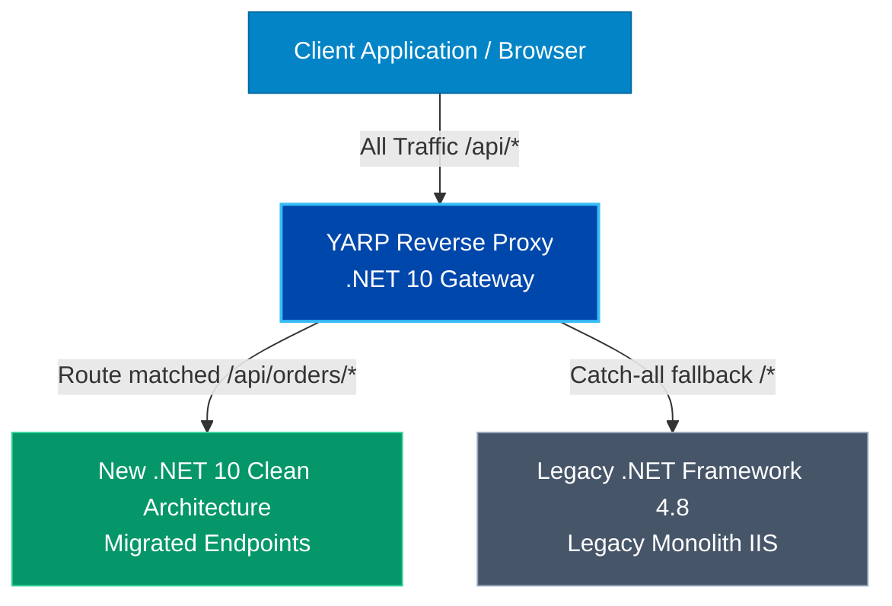

# Legacy .NET Modernization Framework

> Architectural decision matrix, migration blueprints, and zero-downtime strangler patterns for upgrading legacy .NET Framework (4.x, MVC 5, WCF) to .NET 10.

---

## 1. Modernization Assessment Matrix

| Legacy Technology | Recommended Target | Migration Pattern | Complexity | Key Risk |
| :--- | :--- | :--- | :---: | :--- |
| **ASP.NET MVC 5** | ASP.NET Core 10 Controllers / Vue 3 | Strangler Fig via YARP proxy | Medium | Session state sharing |
| **WCF (SOAP Services)** | CoreWCF (interim) or gRPC / REST | Contract-First Interface Mapping | High | Binary serialization quirks |
| **EF 6 (.edmx XML)** | EF Core 10 (Code-First) + Dapper | Dual Persistence Migration | High | Implicit lazy-loading traps |
| **ASP.NET Web Forms** | Headless REST APIs + Vue 3 SPA | Total View Decoupling | High | State machine tied to ViewState |
| **ASP.NET Web API 2** | ASP.NET Core 10 Minimal APIs | Direct Route Porting | Low | Custom ActionFilters |

---

## 2. The Strangler Fig Pattern (Zero Downtime)

Never attempt a "big-bang" rewrite. Legacy enterprise workloads must be migrated incrementally using **YARP (Yet Another Reverse Proxy)**:

### 2.1 Implementation Protocol

1. **Step 1: Deploy YARP in front**: Direct 100% of incoming production traffic through the YARP proxy. All routes default to the legacy monolith.
2. **Step 2: Carve out bounded context**: Build the new vertical slice (e.g., `Orders` or `Invoicing`) in a clean .NET 10 service following Clean Architecture.
3. **Step 3: Route flip**: Reconfigure YARP to route `/api/orders/*` to the .NET 10 service. The legacy monolith never receives those calls again.
4. **Step 4: Repeat until exhaustion**: Decommission legacy IIS server when zero routes remain.

---

## 3. Data Integrity: Dual-Write & Shadow Running

When financial ledgers, policy calculations, or mission-critical inventory are being modernized, implement **Shadow Running**:

1. Write requests are routed to both the legacy and modern pipelines concurrently.
2. The legacy result is returned to the user (source of truth).
3. The modern result is compared asynchronously against the legacy output in an automated audit queue.
4. Discrepancies are flagged and reconciled until 100.00% mathematical parity is verified over a 30-day baseline before promoting the modern pipeline to primary.
